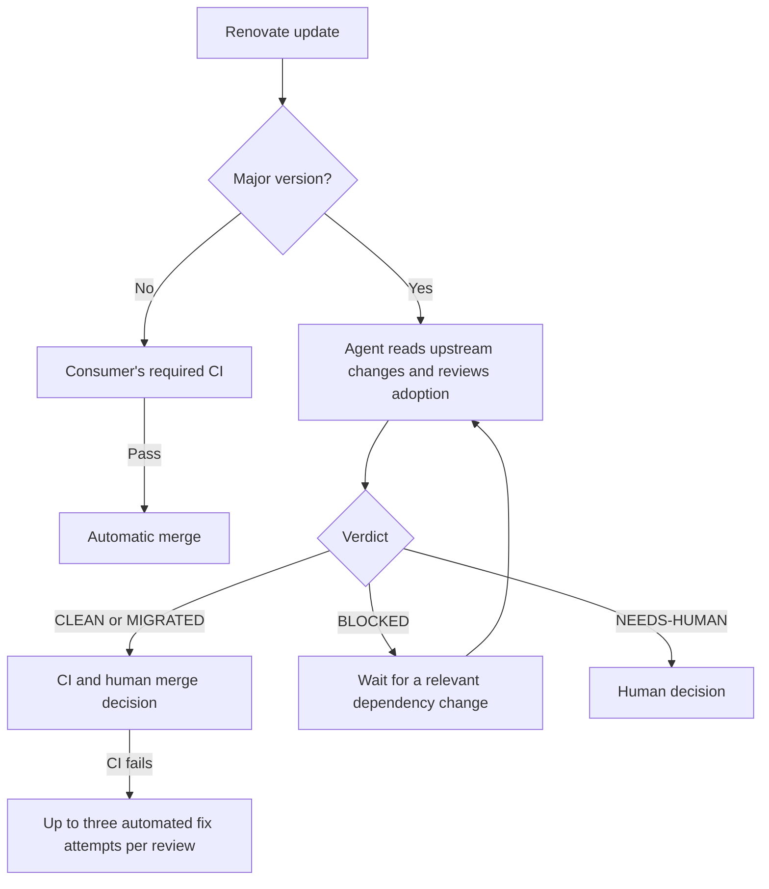

# Upkeep

Dependency updates that keep moving, with a human decision for major versions.

Upkeep combines Renovate, GitHub Actions, and Claude Code to keep routine updates automatic and make
major updates reviewable. It runs in your repository using your CI, project instructions, and
credentials.

**Current release: [v0.1.0](https://github.com/BohdanMoroz11/upkeep/releases/tag/v0.1.0).** The
implementation is used by
[Bohdan Moroz's personal website](https://github.com/BohdanMoroz11/personal-website), where it
originated. See the [verification record](docs/verification.md) for hosted observations and limits.

## Quick start

1. Configure Renovate, repository auto-merge, and required CI checks using [setup](docs/setup.md).
2. Create and install your own GitHub App, then add the four repository configuration values listed
   in setup.
3. Extend the preset in your Renovate configuration:

   ```json
   {
     "extends": ["github>BohdanMoroz11/upkeep#v0.1.0"]
   }
   ```

4. Copy the three [consumer workflow wrappers](examples/npm/.github/workflows) into your
   repository's `.github/workflows/` directory. They already reference `v0.1.0`. Set the CI
   filename/name and sanity command for your project.
5. Run the watchdog manually with `credentials_only: true` to verify authentication, then follow the
   adoption checks in setup.

Your existing CI remains the merge gate. Majors require a human merge decision. No npm dependency or
hosted service is needed to consume Upkeep.

## The flow



- Non-major updates are grouped and eligible for automatic merge after required CI passes.
- Each major gets its own PR and an evidence-backed verdict. Majors require a human merge.
- Uninstallable branches remain reviewable: installation failures are evidence.
- Blocked updates stay open and quiet until the target or recorded blockers change.
- Stale events, retry limits, missing verdicts, and workflow failures are handled explicitly.

Review [behavior](docs/behavior.md) for verdicts and state transitions, and
[operations](docs/operations.md) for recovery.

## Repository guide

| Path                       | Purpose                                       |
| -------------------------- | --------------------------------------------- |
| `default.json`             | Shareable Renovate preset                     |
| `.github/workflows/ci.yml` | Validation for Upkeep itself                  |
| `src/`                     | Controller decisions and API orchestration    |
| `actions/controller/`      | Bundled standalone controller action          |
| `prompts/`                 | Generic review and retry instructions         |
| `tests/fixtures/`          | Sanitized regression event cases              |
| `examples/npm/`            | Consumer preset and executable event wrappers |
| `docs/`                    | Setup, behavior, and architecture             |

Start with [setup](docs/setup.md), [behavior](docs/behavior.md), and
[architecture](docs/architecture.md). The [npm example](examples/npm/README.md) contains the
release-pinned caller configuration.

## Scope

Version 0.1 supports GitHub.com, Renovate, npm with a root `package-lock.json`, and Claude Code.
Other package managers, monorepo subdirectories, GitHub Enterprise Server, and model providers are
outside this release.

Adopters will configure their own GitHub App and model credential. Upkeep is a public repository of
reusable automation; it does not operate a shared credential service.

## Development

Use Node.js 26 and npm:

```sh
npm ci --ignore-scripts
npm run check
```

`check` runs regression tests, standalone-bundle checks, formatting, and Renovate preset validation.
CI also checks workflow syntax and reusable-workflow source selection. See
[CONTRIBUTING.md](CONTRIBUTING.md).

See the [verification record](docs/verification.md), [release policy](docs/releases.md), and
[changelog](CHANGELOG.md) for evidence and release status.

## License

[MIT](LICENSE), copyright Bohdan Moroz.
