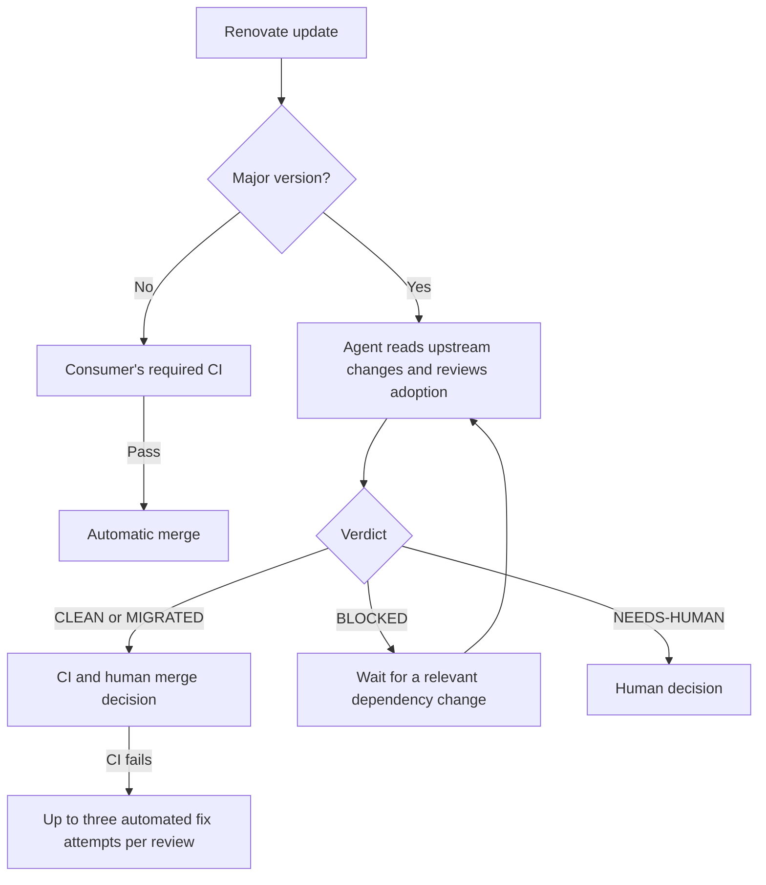

# Upkeep

Dependency updates that keep moving, with a human decision for major versions.

Upkeep is being extracted from the automation used by
[Bohdan Moroz's personal website](https://github.com/BohdanMoroz11/personal-website). It combines
Renovate, GitHub Actions, and Claude Code to keep routine updates automatic and make major updates
reviewable.

**Status: initial foundation, unreleased.** The Renovate preset is present. Reusable agent workflows
and the controller are not implemented here yet. The website continues using its local
implementation until the shared version is validated.

## The flow



- Non-major updates are grouped and eligible for automatic merge after required CI passes.
- Each major gets its own PR and an evidence-backed verdict. Majors require a human merge.
- Uninstallable branches remain reviewable: installation failures are evidence.
- Blocked updates stay open and quiet until the target or recorded blockers change.
- Stale events, retry limits, missing verdicts, and workflow failures are handled explicitly.

These behaviors already exist in the source website; the extraction will preserve them.

## Repository guide

| Path                       | Purpose                                            |
| -------------------------- | -------------------------------------------------- |
| `default.json`             | Shareable Renovate preset                          |
| `.github/workflows/ci.yml` | Validation for Upkeep itself                       |
| `src/`                     | Controller implementation boundary                 |
| `actions/controller/`      | Controller action packaging boundary               |
| `prompts/`                 | Review and retry prompt boundary                   |
| `tests/fixtures/`          | Sanitized regression event cases                   |
| `examples/npm/`            | Consumer configuration and future trigger wrappers |
| `docs/`                    | Setup, behavior, and architecture                  |

Start with [setup](docs/setup.md), [behavior](docs/behavior.md), and
[architecture](docs/architecture.md). The [npm example](examples/npm/README.md) describes what is
available today and what still needs extraction.

## Scope

The first release targets GitHub, Renovate, npm with `package-lock.json`, and Claude Code. The
website is the integration consumer; fixtures and controlled PRs cover the relevant event cases. A
second project is not a release requirement.

Adopters will configure their own GitHub App and model credential. Upkeep is a public repository of
reusable automation; it does not operate a shared credential service.

## Development

Use Node.js 26 and npm:

```sh
npm ci --ignore-scripts
npm run check
```

`check` validates formatting and the preset with Renovate's configuration validator. It does not
claim to test the unimplemented controller or agent workflows. See
[CONTRIBUTING.md](CONTRIBUTING.md).

Extraction is tracked in the
[source project's umbrella issue](https://github.com/BohdanMoroz11/personal-website/issues/64) and
[extraction issue](https://github.com/BohdanMoroz11/personal-website/issues/68). There is no release
tag or stable workflow interface yet.

## License

[MIT](LICENSE), copyright Bohdan Moroz.
